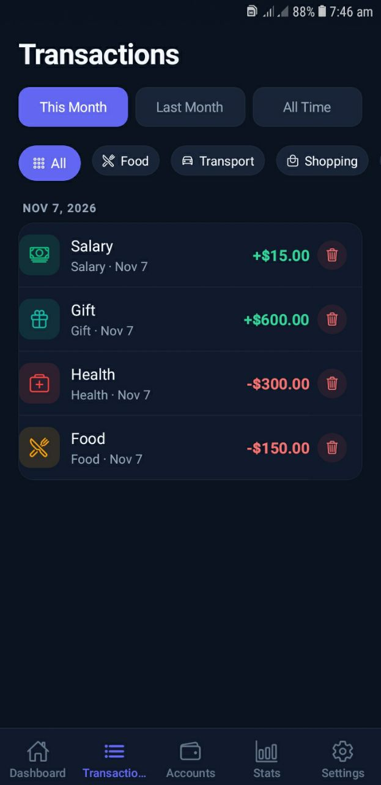
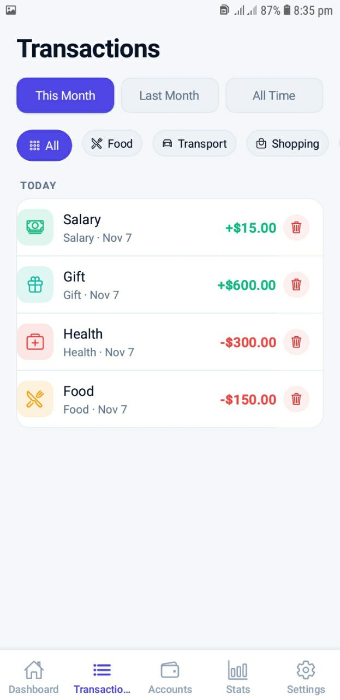
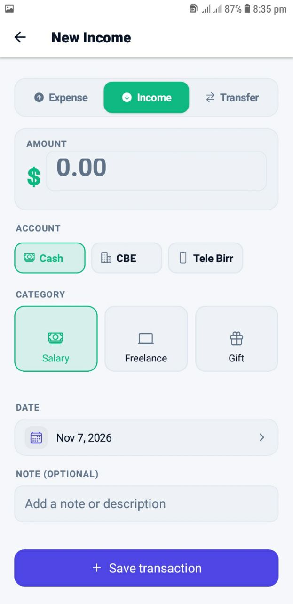
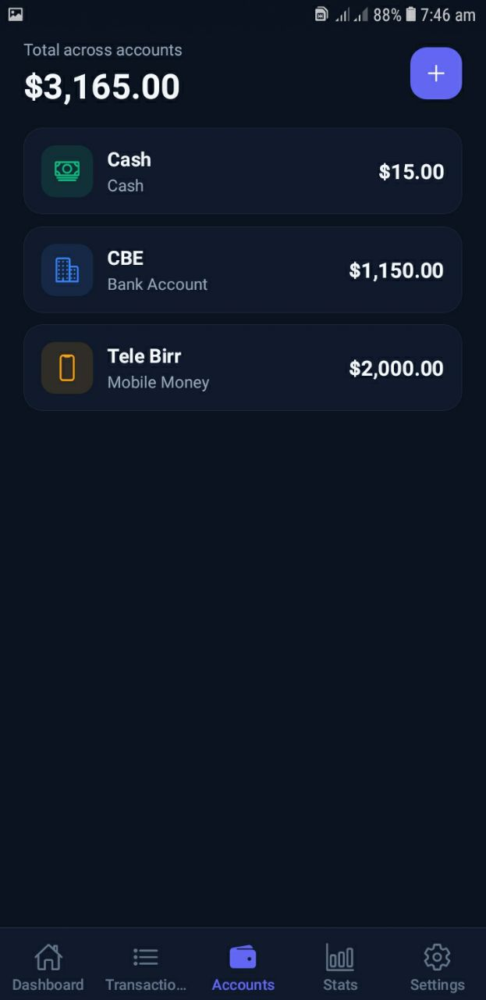
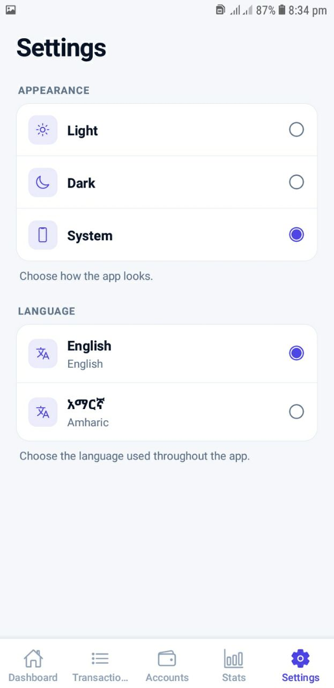

# BirrFlow – Personal Expense Tracker

**BirrFlow** is a modern personal finance management mobile application built with React Native, Expo, and TypeScript. It helps users manage their money, track daily income and expenses, organize financial accounts, and understand their spending habits.

Designed with a clean interface and intuitive navigation, BirrFlow provides an accessible way to monitor personal finances through interactive dashboards, transaction management, and financial statistics.

The application follows a local-first architecture, storing financial records directly on the user's device without requiring a backend server.

---

## Download the Application

Try BirrFlow on your Android device.

Scan the QR code below to access the latest available installation build.

<p align="center">
  
</p>

<p align="center">
  <a href="https://expo.dev/accounts/surafel2113s-team/projects/birrflow/builds/1174d4ec-c85d-45f7-abe3-1f21669f4999">
    
  </a>
</p>

---

## Application Preview

BirrFlow provides a clean and intuitive interface with support for both light and dark themes.

### Dashboard

The dashboard provides a quick overview of personal financial activities, including total balance, income, expenses, and recent transactions.

<p align="center">
  
  &nbsp;&nbsp;
  
</p>

<p align="center">
  <sub>Light Theme &nbsp; | &nbsp; Dark Theme</sub>
</p>

### Transaction Management

Manage income and expenses, organize transactions by category, and review financial activities.

<p align="center">
  
  &nbsp;&nbsp;
  
</p>

<p align="center">
  <sub>Transaction History – Light & Dark Themes</sub>
</p>

### Add Transactions

Quickly record new income and expense transactions with relevant financial details.

<p align="center">
  
</p>

### Account Management

Manage financial accounts and monitor individual account balances.

<p align="center">
  
</p>

### Settings and Personalization

Customize the application experience through theme and language preferences.

<p align="center">
  
</p>

---

## Features

### Dashboard
- View total financial balance.
- Monitor total income and expenses.
- View recent financial transactions.
- Get an overview of financial activities.

### Transaction Management
- Create income and expense transactions.
- Edit existing transactions.
- Delete transactions.
- Organize transactions using categories.
- View complete transaction history.
- Filter transactions by category and date.

### Financial Statistics
- View monthly income and expenses.
- Analyze spending patterns.
- Visualize financial activities through charts.
- Monitor financial progress over time.

### Account Management
- Manage multiple financial accounts.
- Track individual account balances.
- Organize financial activities by account.

### Personalization
- Light and dark themes.
- Multilingual interface.
- Persistent application settings.
- Responsive and intuitive mobile interface.

### Local Data Persistence
- Store financial records directly on the device.
- Preserve transaction history after restarting the application.
- Persist application settings.
- Manage financial records without requiring a backend server.

---

## Technology Stack

| Technology | Purpose |
|---|---|
| React Native | Cross-platform mobile development |
| Expo | Development and application deployment |
| TypeScript | Static typing and maintainability |
| AsyncStorage | Local data persistence |
| React Navigation | Application navigation |
| Context API | Global state management |
| Expo Vector Icons | Application iconography |

---

## Project Structure

```text
expense-tracker-app/
│
├── assets/
│
├── docs/
│   ├── birrflow-install-qr.png
│   └── screenshots/
│       ├── Accounts.jpg
│       ├── Add-transaction.jpg
│       ├── Overview-dark.jpg
│       ├── Overview-light.jpg
│       ├── Setting.jpg
│       ├── Transaction-dark.jpg
│       └── Transaction-light.jpg
│
├── src/
│   ├── components/
│   ├── screens/
│   ├── navigation/
│   ├── context/
│   ├── storage/
│   ├── constants/
│   ├── types/
│   └── utils/
│
├── App.tsx
├── app.json
├── package.json
└── tsconfig.json
```

---

## Getting Started

Follow these instructions to run BirrFlow locally.

### Prerequisites

Make sure you have installed:

- Node.js
- npm
- Expo Go on your mobile device

### 1. Clone the Repository

```bash
git clone https://github.com/Surafel13/Expense-tracker-mobile-app.git
```

### 2. Navigate to the Project

```bash
cd Expense-tracker-mobile-app
```

### 3. Install Dependencies

```bash
npm install
```

### 4. Start the Development Server

```bash
npx expo start
```

### 5. Run on Your Mobile Device

1. Install Expo Go on your Android or iOS device.
2. Connect your phone and computer to the same Wi-Fi network.
3. Scan the QR code displayed in your terminal.
4. Open the application using Expo Go.

---

## Data Persistence and Privacy

BirrFlow follows a local-first data management approach.

Financial information is stored locally using AsyncStorage rather than being sent to an external backend server.

Key characteristics:

- Transactions persist across application restarts.
- Application preferences are stored locally.
- No external database server is required.
- Financial records are managed on the user's device.

**Security note:** AsyncStorage is not encrypted by default. Sensitive information should use appropriate encrypted storage solutions.

---

## Future Improvements

Potential improvements for future versions include:

- Encrypted local data storage.
- Financial data export (CSV and PDF).
- Automated data backup and restoration.
- Budget planning and spending limits.
- Recurring transactions.
- Advanced financial reports.
- Additional chart visualizations.
- More language support.

---

## Project Goals

BirrFlow was developed to:

- Simplify personal financial management.
- Help users understand their spending habits.
- Provide an intuitive way to track income and expenses.
- Demonstrate practical React Native and TypeScript development.
- Explore local-first mobile application architecture.

---

## Developer

**Surafel Tesfaye**

Software Engineering Student | Junior Full-Stack Developer | Mobile App Developer

- GitHub: [@Surafel13](https://github.com/Surafel13)
- Portfolio: [Personal Portfolio](https://my-portfolio-ten-rho-54.vercel.app)

---

<p align="center">
  <strong>BirrFlow</strong>
  <br />
  Personal Finance Management, Simplified.
  <br /><br />
  Built with React Native, Expo, and TypeScript.
</p>
